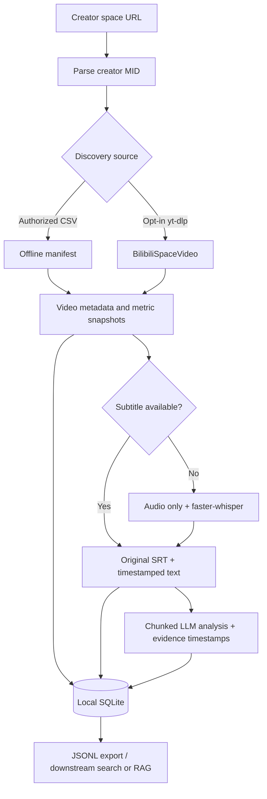

# Bilibili Creator Intelligence

**Local-first creator analytics and video knowledge extraction: Bilibili space URL → video discovery → engagement metadata → subtitles / ASR → LLM knowledge → SQLite.**

[简体中文](README.zh.md) · [Architecture](docs/architecture.md) · [Source permissions](docs/source-adapters.md) · [Verification](docs/verification.md) · [Security](SECURITY.md)

> [!IMPORTANT]
> Remote discovery uses yt-dlp's `BilibiliSpaceVideo` extractor and is **best-effort, opt-in and permission-dependent**. It is *not* an official Bilibili API integration, does not bypass access controls and **cannot prove that all uploads have been discovered**. Use only where your rights and Bilibili's terms permit. An offline manifest workflow is also provided.

## Pipeline



## Quick start (Python 3.11+, macOS/Linux)

```bash
# macOS: brew install ffmpeg
# Ubuntu/Debian: sudo apt-get install ffmpeg
python3 -m venv .venv
source .venv/bin/activate
python -m pip install -e '.[all,dev]'
cp .env.example .env
```

Set `OPENAI_API_KEY` in `.env` if you want LLM analysis. The default model is `gpt-4o-mini`; override `BCI_LLM_MODEL` and optionally `OPENAI_BASE_URL` for supported compatible services. faster-whisper runs locally; it can download model weights on the first run.

### A. Discover creator videos from a space URL (opt-in)

```bash
# Enumerate accessible videos; does not download audio/video or invoke an LLM
bci discover \
  --space-url 'https://space.bilibili.com/123456/video' \
  --source yt-dlp \
  --authorized-content-use

# Small trial with full pipeline (maximum 3 discovered videos)
bci run \
  --space-url 'https://space.bilibili.com/123456/video' \
  --source yt-dlp --max-videos 3 \
  --authorized-content-use

# Metadata only: no subtitle/audio/ASR/LLM
bci run \
  --space-url 'https://space.bilibili.com/123456/video' \
  --source yt-dlp --max-videos 3 --authorized-content-use \
  --metadata-only
```

`--max-videos 0` (default) means **no caller-imposed cap**, *not* a completeness guarantee. A capped scan is explicitly marked incomplete in the discovery report, and its downstream processing is bounded to the just-discovered videos. If access is rejected (e.g. 352/412), stop, review permissions and try the offline workflow rather than bypassing restrictions.

### B. Import an authorized CSV manifest (offline)

```bash
bci ingest \
  --space-url 'https://space.bilibili.com/123456/video' \
  --manifest examples/videos.csv

# Can later process the imported videos if you have permission
bci process --mid 123456 --authorized-content-use
```

A manifest needs `video_url` and may include `title`, `description`, `pubdate`, `duration`, `tags`, `raw_metadata_json`, `view_count`, `like_count`, `coin_count`, `favorite_count`, `share_count`, `danmaku_count`, `comment_count`. Unknown counters stay SQLite `NULL`, not zero. The sample CSV contains placeholder data and is not a real creator feed.

### C. Re-run and export

```bash
bci process --mid 123456 --authorized-content-use --limit 10
bci stats
bci export --mid 123456 --output data/export/creator.jsonl
```

Use `--no-metadata`, `--no-subtitles`, `--no-asr`, `--no-llm`, or `--metadata-only` to control remote access and computational costs. If LLM is disabled, no API key is needed. `bci ingest`, `bci stats` and `bci export` work offline.

## Stored data

| SQLite table | Data |
| --- | --- |
| `creators` | MID, space URL, source and provenance |
| `videos` | BV/AV, title, description, dates, duration, tags and sanitized source metadata |
| `video_stats` | Time-stamped view, like, coin, favorite, share, danmaku and comment counters (missing = `NULL`) |
| `transcripts` | Original subtitle, timestamped text, language/source, SHA-256 and local path |
| `analyses` | Structured JSON/Markdown, model, prompt version and transcript hash |
| `discovery_runs` | Discovery source, result count, status and coverage caveats |
| `jobs` | Processing stage events, successes, failures and skips |

Files live under `data/artifacts/<BVID>/`; the SQLite DB defaults to `data/bilibili.sqlite3`. Both are ignored by Git. The LLM uses timestamped segments, returns key points, arguments, concepts, conclusions and gaps, and caches analyses by `(video, transcript hash, model, prompt version)`. An LLM analysis is not a fact-check. Clip/segment timestamps should be manually verified before quoting.

## Current limitations / safety

- The yt-dlp creator-list extractor relies on Bilibili's changing web endpoints. It may fail or return a partial accessible list. It does not enumerate deleted, private or inaccessible videos. Nested playlist entries currently fail closed rather than silently reporting success.
- Video metadata enrichment may lack `coin_count`, `favorite_count`, `share_count` and other engagement metrics. Such values can be filled from an authorized manifest but are never invented.
- Some video archives contain multiple parts (P pages). This release treats each BV/AV as one archive; a full multi-part transcript requires a future per-part implementation.
- Only subtitle or audio is downloaded during processing; no entire video is deliberately stored. Audio can be large. The local ASR model may download weights and use CPU/GPU resources.
- Transcripts leave the local device when `--no-llm` is **not** provided. Obtain consent and check provider retention/privacy settings before uploading third-party content. Never check cookies, secrets, transcripts or the SQLite database into Git.
- Discovery is serial, network access is explicitly gated, and failures are surfaced. No CAPTCHA bypass, proxy rotation or access-control evasion is implemented.

## Development and validation

```bash
python -m pip install -e '.[dev]'
python -m compileall -q src
python -m pytest -q
```

Offline tests use deterministic fake provider responses and never contact Bilibili or bill an LLM. See [verification matrix](docs/verification.md) for directly checked implementation claims and the outstanding live-network integration checks.

## References

- [yt-dlp supported extractors](https://github.com/yt-dlp/yt-dlp/blob/master/supportedsites.md) and [Bilibili implementation](https://github.com/yt-dlp/yt-dlp/blob/master/yt_dlp/extractor/bilibili.py)
- [yt-dlp command/subtitle documentation](https://github.com/yt-dlp/yt-dlp#subtitle-options)
- [Bilibili Open Platform documentation](https://openhome.bilibili.com/doc) and [single authorized archive detail API](https://openhome.bilibili.com/doc/4/d9554788-dcef-f139-6217-b487d41c3826)
- [faster-whisper](https://github.com/SYSTRAN/faster-whisper)
- [OpenAI JSON response mode](https://platform.openai.com/docs/guides/structured-outputs)

MIT licensed; see [LICENSE](LICENSE). Contribute via [CONTRIBUTING.md](CONTRIBUTING.md).
