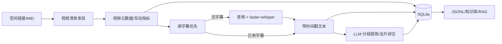

# Bilibili Creator Intelligence｜B 站 UP 主内容智能分析

**UP 主空间链接 → 视频发现 → 播放/点赞/投币等元数据 → 原字幕/Whisper → LLM 核心观点 → 本地 SQLite。**

[English](README.md) · [架构说明](docs/architecture.md) · [数据源与权限](docs/source-adapters.md) · [验证依据](docs/verification.md) · [安全策略](SECURITY.md)

> [!IMPORTANT]
> 提供**明确授权后才能启用**的空间视频发现能力，底层使用 yt-dlp 的 `BilibiliSpaceVideo` 提取器，而非 B 站官方开放平台 API。受到平台权限、反爬限制及可见性影响，**无法保证列出的就是某位 UP 主的所有视频**。请遵守版权与平台协议；无适用权限时，使用离线 CSV 导入。

## 功能和数据链路



### 1. 安装（macOS / Linux，Python 3.11+）

```bash
# macOS
brew install ffmpeg

python3 -m venv .venv
source .venv/bin/activate
python -m pip install -e '.[all,dev]'
cp .env.example .env
```

如需 LLM：在 `.env` 中配置 `OPENAI_API_KEY`。默认 `BCI_LLM_MODEL=gpt-4o-mini`；如使用兼容服务，配置 `OPENAI_BASE_URL` 和对应的模型名。首次运行 faster-whisper 可能下载模型权重。

### 2. 仅用空间链接发现视频（需适用权限）

```bash
# 只发现视频、落地 SQLite，不下载音频或调用模型
bci discover \
  --space-url 'https://space.bilibili.com/123456/video' \
  --source yt-dlp \
  --authorized-content-use

# 限定最多发现 3 个视频，用于试运行完整流程
bci run \
  --space-url 'https://space.bilibili.com/123456/video' \
  --source yt-dlp \
  --max-videos 3 \
  --authorized-content-use

# 仅采集列表与单视频元数据：不会下载字幕/音频，也不会进行 ASR 或 LLM
bci run \
  --space-url 'https://space.bilibili.com/123456/video' \
  --source yt-dlp --max-videos 3 \
  --authorized-content-use --metadata-only
```

不设置 `--max-videos` 意味着**没有人为设置条数上限**，不代表自动发现全部投稿。`--max-videos 3` 会将发现记录标记为不完整，并只处理本轮发现的那些视频，不会意外处理数据库里的全部历史视频。发现接口可能返回 352/412 等访问限制；程序会报错记录，不会提供绕过风控的方法。

### 3. 更可控的离线 CSV 清单导入

```bash
bci ingest \
  --space-url 'https://space.bilibili.com/123456/video' \
  --manifest examples/videos.csv

# 授权条件允许后，再处理此前导入的视频
bci process --mid 123456 --authorized-content-use
```

CSV 必需列 `video_url`。可选字段包括标题、简介、日期、播放数 `view_count`、点赞 `like_count`、投币 `coin_count`、收藏 `favorite_count`、分享 `share_count`、弹幕 `danmaku_count`、评论 `comment_count` 等。**没拿到的指标写入 `NULL`，不是 0**。示例 CSV 仅为格式演示，不能视作真实数据。

### 4. 增量处理、成本控制和导出

```bash
bci process --mid 123456 --authorized-content-use --limit 10
bci stats
bci export --mid 123456 --output data/export/creator.jsonl
```

`--no-metadata`、`--no-subtitles`、`--no-asr`、`--no-llm` 可分别关闭相应阶段；`--metadata-only` 关闭字幕、ASR、LLM。`ingest / stats / export` 可完全离线运行。

## SQLite 数据结构

| 表 | 内容 |
| --- | --- |
| `creators` | UP 主 MID、空间链接、数据来源 |
| `videos` | BV/AV、标题、描述、发布时间、时长、标签及筛选后的原始元数据 |
| `video_stats` | 播放、点赞、投币、收藏、分享、弹幕、评论的时间快照 |
| `transcripts` | 字幕原文、时间戳、字幕来源、语言、SHA-256 |
| `analyses` | LLM 结构化 JSON、Markdown、模型与 Prompt 版本 |
| `discovery_runs` | 发现轮次、来源、状态、数量和覆盖率提示 |
| `jobs` | 字幕、ASR、LLM 等处理阶段事件 |

数据默认存放于 `data/bilibili.sqlite3`，音频、字幕、分析产物默认位于 `data/artifacts/<BVID>/`。本地数据目录和 `.env` 不会提交到 Git。相同转录内容使用 SHA-256 去重，同一内容/模型/提示词版本避免重复的 LLM 请求。

## 可靠性边界

- **空间链接不等于完整投稿列表。** yt-dlp 提取器可能被平台拒绝或返回部分可访问视频；无法恢复已删除、私密和不可访问内容。遇到非视频的嵌套列表，会明确报错，而不是悄悄少抓。
- **投币/收藏/分享并非对所有视频都可用。** 单视频提取器有时仅能获得播放、点赞、评论等字段；其他字段以有权限的数据源为准。
- **多 P 视频当前按 BV/AV 作为一条投稿处理。** 逐 P 完整转录尚未实现，不应将单 P 结果当作整条投稿。
- **字幕和音频取决于权限。** 没有可用字幕时才下载音频，执行本地 Whisper；并不下载完整 MP4。
- **LLM 会接触视频文本。** `--no-llm` 才能完全避免向外部模型提供字幕；模型分析和引用时间戳需要人工核查。
- **平台许可与版权优先。** `--authorized-content-use` 是操作人确认，不是自动取得授权；程序不会绕过登录、验证码或访问控制。

## 测试与审计

```bash
python -m compileall -q src
python -m pytest -q
```

所有自动化测试使用离线模拟，不联系 B 站、不下载真实内容、不产生 LLM 账单。CI 在 Python 3.11/3.13 上验证。详细设计与验证范围见 [技术验证文档](docs/verification.md)。

## 依据

- [yt-dlp 支持站点](https://github.com/yt-dlp/yt-dlp/blob/master/supportedsites.md)、[Bilibili 提取器源码](https://github.com/yt-dlp/yt-dlp/blob/master/yt_dlp/extractor/bilibili.py)
- [yt-dlp 字幕及下载选项](https://github.com/yt-dlp/yt-dlp#subtitle-options)
- [B 站开放平台](https://openhome.bilibili.com/doc)、[单一稿件官方授权详情接口](https://openhome.bilibili.com/doc/4/d9554788-dcef-f139-6217-b487d41c3826)
- [faster-whisper](https://github.com/SYSTRAN/faster-whisper)
- [OpenAI JSON / Structured Outputs](https://platform.openai.com/docs/guides/structured-outputs)

代码使用 MIT License，欢迎按 [CONTRIBUTING.md](CONTRIBUTING.md) 提交改进。
