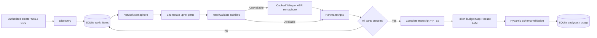

# Architecture v0.3.0 — guarantees and failure boundaries

## Pipeline

## SQLite schema

- `creators` → `videos` 1:N; `videos` → `video_stats` 1:N nullable snapshots.
- `videos` → `video_parts` 1:N (PK: video_id, part_index), each part → `part_transcripts` 1:N immutable by SHA-256.
- Complete assembly → `transcripts` (one SHA-256 version per submission) → `transcript_segments` (part_index, start_ms, end_ms, text) → `transcript_segments_fts` (FTS5 trigram).
- `transcripts` → `analyses` 1:N, uniquely identified by (video_id, transcript_sha256, model, prompt/schema fingerprint). Export looks up analysis via latest transcript_id, **not** latest analysis independent of the transcript.
- `work_items` is the durable scheduling table (one pipeline stage row per video) while `jobs` is a structured stage-event log, and `discovery_runs` audits discovery attempts.
- `llm_usage` logs each request attempt, response token usage when available, latency, stage, outcome and estimated cost when both user-provided token prices are set.

Database initialization uses additive `CREATE TABLE/INDEX IF NOT EXISTS` operations. Existing v0.2 user data remains, but legacy transcripts are not automatically reindexed into FTS5; processing parts builds complete new versions. Back up SQLite (including WAL files) before upgrading or performing any manual migration.

## Multi-P behavior

The yt-dlp Bilibili extractor enumerates page lists for an anthology; each page has a part URL with `?p=N`. The inventory adapter rejects missing/unknown/partial/nested entries instead of marking them complete. A fresh inventory is stored before processing content. Per-part subtitles are verified for cues and heuristic coverage (end-time/duration, threshold 25%); only when unavailable does audio ASR run. `part_transcripts` are resumable and cached. All part indices must be covered before combined SRT, complete timestamped transcript and search segments are published. In a combined text, each cue retains `[P2 local-time]` so citations remain verifiable against that part. Combined SRT uses cumulative duration offsets, which are estimates if source duration is unavailable.

Existing part inventory is cached; re-discovery of changed/edited video part inventories is not automatic. Interactive videos and unsupported shapes explicitly fail. yt-dlp extraction can return incomplete accessible results because of platform permissions and anti-abuse systems.

## Concurrency, recovery, spend

Video workers: ThreadPoolExecutor (default 2). Each SQLite job is claimed under `BEGIN IMMEDIATE` with lease token and expiry, and heartbeats renew its ownership. Stale claims may be reclaimed. A retry gets exponential backoff with jitter and max_attempts; exhausted jobs require explicit `--retry-failed`. Claim/finish use fencing tokens. **This is at-least-once external processing:** a network/LLM request may finish after its lease is lost, and charges may duplicate if the process crashes between the API response and the SQLite commit.

Shared stage semaphores default network=1, ASR=1, LLM=2. Whisper model weights are cached in-process; per-process ASR semaphore bounds inference calls. `RollingMinuteLimiter` accounts for each LLM request attempt and reserves estimated prompt+max output tokens within process-local RPM and TPM windows. This is **not** an account-global distributed rate limiter.

The model SDK has automatic retries disabled; the application retries 429/5xx/network errors and invalid JSON/schema up to 3 request attempts. Using `BCI_LLM_MODE=schema` requires a provider/model supporting Chat Completions JSON Schema Strict outputs; compatibility mode requires explicit `BCI_LLM_MODE=json`. The budget uses estimates and **user-specified** per-million-token prices; it is a safeguard, not billing reconciliation. Some failed requests may still be billed even without returned usage.

The prompt fingerprint is SHA-256(prompt text + JSON schema) encoded into PROMPT_VERSION. Changing model/prompt input produces a new analysis. Input segmentation uses tiktoken, always bounds message input by configured token budgets, and pairwise reduction bounds fan-in. Outputs are schema checked but not fact checked; evidence timestamps need independent verification. The output budget may be insufficient for highly detailed JSON; increase deliberately.

## Outstanding research and operational limits

- Live Bilibili/Whisper/LLM integration not run in CI; permitted test content and credentials are required.
- Official Bilibili Open Platform adapter remains a stub until an approved application and scopes exist.
- Prompt/schema policy and token estimation for non-OpenAI compatible model families may need a provider-native tokenizer.
- No cross-host global rate limiter, shared secret manager, external billing reconciliation or automatic storage retention policy.
- Existing inventory is cached; revised part lists require a future refresh/migration strategy.
